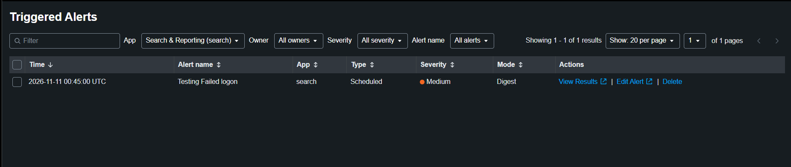
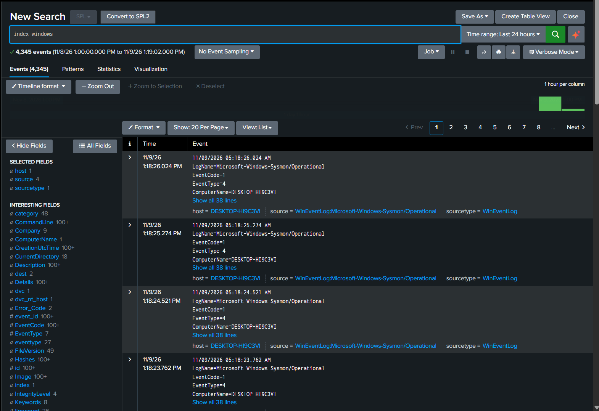
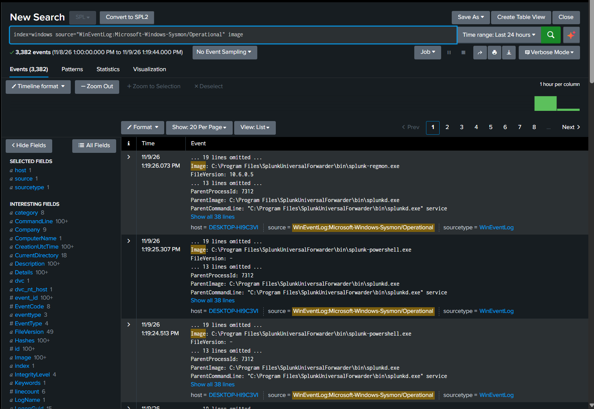
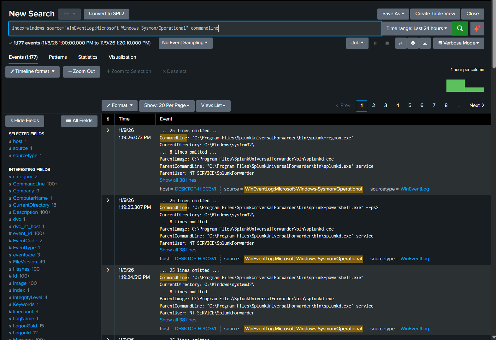

# 📊 Splunk SIEM Lab

A home SIEM lab using **Splunk Enterprise** to collect, parse, and alert on Windows security events, built to practice the log analysis and detection work of a SOC analyst.

---

## 🧰 Lab Environment

| Component | Details |
|---|---|
| SIEM | Splunk Enterprise on **Ubuntu Server 26.04** VM (headless) |
| Endpoint | **Windows 10** VM with Splunk Universal Forwarder |
| Telemetry | Windows Event Logs (Security, System, Application) + **Sysmon** (SwiftOnSecurity config) |
| Parsing | Splunk Add-on for Windows |
| Host | Both VMs on the same host machine |

```
┌──────────────────────────────┐              ┌──────────────────────────────┐
│  Windows 10 VM               │              │  Ubuntu Server VM            │
│  • Windows Event Logs        │   forward    │  Splunk Enterprise           │
│  • Sysmon (SwiftOnSecurity)  │ ───────────► │  • index: windows            │
│  • Universal Forwarder       │              │  • Add-on for Windows        │
└──────────────────────────────┘              │  • Alerts                    │
                                              └──────────────────────────────┘
```

---

## ✅ What I Built

### 1. Log Forwarding
- Installed Splunk Enterprise on a headless Ubuntu Server VM.
- Configured the Universal Forwarder on Windows to send Event Logs into a dedicated **`windows`** index.

### 2. Field Parsing with the Splunk Add-on for Windows
- Installed the add-on (.spl) through Splunk Web.
- Events now have structured fields (e.g. `SourceName`, `LogName`) instead of raw text.

### 3. Sysmon Telemetry
- Installed Sysmon with the SwiftOnSecurity config and added a Sysmon input to the forwarder's `inputs.conf`.
- Fields like `Image` and `CommandLine` are parsed by the Windows add-on, so no separate Sysmon add-on was needed.

### 4. Boot-start
- Enabled Splunk boot-start (systemd), so Splunk comes up automatically whenever the VM starts.

### 5. Audit Policy
Several of the events used below are **not logged by default** on Windows 10. I checked the audit policy on the endpoint (PowerShell as Administrator):

```powershell
auditpol /get /category:*
```

and confirmed that **Logon**, **User Account Management** and **Security Group Management** were being audited. Scheduled task events (4698) also need **Other Object Access Events**, which was off, so I enabled it:

```powershell
auditpol /set /subcategory:"Other Object Access Events" /success:enable
```

| Subcategory | Events used in this lab |
|---|---|
| Logon | 4624, 4625 |
| User Account Management | 4720 |
| Security Group Management | 4732 |
| Other Object Access Events | 4698, 4699 (scheduled tasks) |
| *(none needed)* | 1102 (Security log), 7045 (System log) |

> **Lesson:** audit policy is **not retroactive**. Activity that happened before a subcategory was enabled is never logged, so the test has to be repeated after enabling it.

### 6. First Alert: Multiple Failed Logons (Event ID 4625)
- Scheduled alert that fires on **5+ failed logons for the same account within 5 minutes** (MITRE ATT&CK T1110, Brute Force).
- The first version had a missing `EventCode` filter and only ran once a week; reviewed and fixed it, then tested it end to end. ✅

```spl
index=windows source="wineventlog:security" EventCode=4625
| eval target_user=mvindex(Account_Name, -1)
| bin _time span=5m
| stats count as failures values(Logon_Type) as logon_types values(Workstation_Name) as source_hosts by _time, target_user
| where failures >= 5
```

Full write-up (settings, iteration history, testing): [`detections/multiple-failed-logons-4625.md`](detections/multiple-failed-logons-4625.md)

### 7. Detection Practice
For each exercise I **simulated the attacker technique** on the Windows VM, then wrote and tested an SPL search that finds it, mapped to MITRE ATT&CK.

| # | Exercise | Event ID | MITRE ATT&CK | Severity | Write-up |
|---|---|---|---|---|---|
| 1.1 | Logon Type analysis | 4624, 4625 | T1110, T1021 | Informational | [link](detections/logon-type-analysis-4624-4625.md) |
| 1.2 | Brute force followed by a successful logon | 4625 → 4624 | T1110.001 | High | [link](detections/brute-force-success-4625-4624.md) |
| 1.3 | New local user and group membership change | 4720, 4732 | T1136.001, T1098 | Medium / High | [link](detections/account-creation-group-change-4720-4732.md) |
| 1.4 | Security audit log cleared | 1102, 104 | T1070.001 | High | [link](detections/audit-log-cleared-1102.md) |
| 1.5 | New service and scheduled task | 7045, 4698 | T1543.003, T1053.005 | Medium | [link](detections/service-scheduled-task-7045-4698.md) |

#### Attack chain covered
Together the exercises cover a full attacker story on a single host, and each step leaves a different event:

```
Brute force        Account           Privilege          Persistence           Defense evasion
4625 ×N → 4624 ──► 4720 created ──► 4732 added to ──► 7045 service /     ──► 1102 audit log
(T1110.001)        (T1136.001)       Administrators     4698 sched. task      cleared
                                     (T1098)            (T1543.003,           (T1070.001)
                                                         T1053.005)
```

One event alone can be legitimate (admins do create accounts and services). The same events **in sequence, close together, on one host** are a strong signal, and that is when severity should be raised to Critical.

#### Highlight: brute force followed by success (1.2)
```spl
index=windows source="WinEventLog:Security" (EventCode=4624 OR EventCode=4625)
| eval user=lower(coalesce(mvindex(Account_Name,1), Account_Name))
| search user!="*$" user!="system" user!="dwm-*" user!="umfd-*" user!="anonymous logon"
| transaction user maxspan=10m endswith=eval(EventCode==4624) mvlist=true
| eval failed=mvcount(mvfilter(match(EventCode,"4625")))
| where failed > 5
| table _time user failed eventcount duration
```
It took several iterations to get this right; see the troubleshooting log below and the [write-up](detections/brute-force-success-4625-4624.md).

---

## 🐛 Troubleshooting Log

| Problem | Cause | Fix |
|---|---|---|
| Sysmon events not reaching Splunk; forwarder reported **access denied (error code 5)** | The forwarder service account could not read the Sysmon event channel | Added `NT SERVICE\SplunkForwarder` to the **Event Log Readers** group |
| Alert fired, but on normal activity | Search had no `EventCode=4625` filter, so it counted every Security event | Added the filter and rewrote the detection ([details](detections/multiple-failed-logons-4625.md)) |
| Alert would miss attacks most of the week | `cron_schedule = 0 6 * * 1` (Mondays 06:00 only) with a 5-minute window | Schedule every 5 minutes |
| Failed logons visible on Windows but **not in Splunk**, no obvious error | Free space on `/` fell below Splunk's 5000 MB minimum, so the **indexer paused** data writes | Extended the root partition, restarted Splunk; the forwarder re-sent the queued events |
| `transaction` grouped unrelated logons together | `Account_Name` is **multivalue** in 4624/4625: the first value is the subject (e.g. `DESKTOP-XXXX$`), the second is the target account. Grouping on both mixed my logons with system logons | Group on `mvindex(Account_Name,1)` and filter out machine/system accounts (`*$`, `SYSTEM`, `DWM-*`, `UMFD-*`) |
| 6 failed logons + 1 success never formed one transaction | `startswith=EventCode=4625` **opens a new transaction on every 4625**, so the attempts were split into small groups | Removed `startswith`, kept `endswith` on 4624, and counted failures with `mvfilter` + `mvcount` instead of `eventcount` |
| A single successful logon showed up as **two 4624 events** at the same millisecond | **Linked logon**: a logon by an admin account creates two sessions (filtered and elevated token), so `eventcount` is not a reliable count of attempts | Count the 4625 events directly with `mvfilter` + `mvcount` |
| Scheduled task created, but **4698 never appeared** while 7045 (service) did | 7045 is in the System log and logged by default; 4698 needs the *Other Object Access Events* audit subcategory, which was off | Enabled the subcategory and **recreated the task** (audit policy is not retroactive) |

> **Lesson:** a SIEM can go blind quietly. Splunk only showed a warning in the bell menu; searches simply returned nothing new.
>
> **Lesson:** when a search returns nothing, take it apart pipe by pipe (`| table` after each step) to find where the events disappear.

---

## 📁 Repository Contents

| Path | What it is |
|---|---|
| `forwarder/inputs.conf` | Event Log + Sysmon inputs on the Universal Forwarder |
| `forwarder/outputs.conf` | Forwarding to the Splunk server (IP replaced with a placeholder) |
| `detections/` | Detection write-ups: SPL, attack simulation, testing, MITRE mapping |
| `screenshots/` | Search results and alert screenshots |

---

## 📸 Screenshots

### Triggered alert (4625 brute-force detection)


### Windows events in the `windows` index
Events from the forwarder with fields extracted by the Splunk Add-on for Windows (left panel).



### Sysmon process creation (Event ID 1)
Sysmon adds process-level detail that the default Windows logs lack: the executable (`Image`), its full `CommandLine`, and the parent process.

| `Image` | `CommandLine` + parent process |
|---|---|
|  |  |

Screenshots for each detection exercise are in its write-up under [`detections/`](detections/).

---

## 🗺️ Roadmap

- [x] Brute-force detection on 4625
- [x] Detection practice on 4624 and other key Event IDs (4625 → 4624, 4720, 4732, 1102, 7045, 4698)
- [ ] Turn the detection practice searches into scheduled alerts
- [ ] Password spraying detection (many accounts, one source)
- [ ] Correlation search for the full attack chain on one host
- [ ] Dashboard for the attack chain
- [ ] More Sysmon-based detections (process creation, network connections)
- [ ] Add **Elastic** to the lab
- [ ] Integrate with my Wazuh Endpoint Security Lab

---

*Part of my roadmap toward becoming a **SOC Analyst** (Phase 2: SIEM & Log Analysis).*
