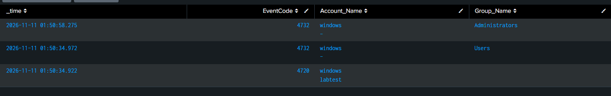

# Detection Practice 1.3: New Local User and Group Membership Change (4720, 4732)

| | |
|---|---|
| **Type** | Detection search (not yet scheduled) |
| **Data source** | Windows Security log (`index=windows`, `source=WinEventLog:Security`) |
| **MITRE ATT&CK** | [T1136.001 Create Account: Local Account](https://attack.mitre.org/techniques/T1136/001/), [T1098 Account Manipulation](https://attack.mitre.org/techniques/T1098/) |
| **Severity** | Medium (4720) / High (4732 to Administrators) |
| **Status** | ✅ Tested: both events found after creating a test user and adding it to Administrators |

## What it detects

- **4720:** a new local user account was created. Attackers create their own account so they keep access even if the original password is changed (**persistence**, T1136.001).
- **4732:** a member was added to a security-enabled local group. Adding an account to **Administrators** gives it full control of the host (**account manipulation / privilege escalation**, T1098).

| EventCode | Meaning |
|---|---|
| 4720 | User account created |
| 4722 | User account enabled (usually logged together with 4720) |
| 4738 | User account changed (usually logged together with 4720) |
| 4732 | Member added to a local security group |
| 4728 / 4756 | Member added to a global / universal group (domain) |

Requires the **User Account Management** and **Security Group Management** audit subcategories.

## Attack simulation

Run in an Administrator command prompt on the Windows 10 VM:

```cmd
net user labtest P@ssw0rd1 /add
net localgroup administrators labtest /add
```

Cleanup:

```cmd
net user labtest /delete
```

## SPL

```spl
index=windows source="WinEventLog:Security" (EventCode=4720 OR EventCode=4732)
| table _time, EventCode, Account_Name, Group_Name
```

| Line | Why |
|---|---|
| `(EventCode=4720 OR EventCode=4732)` | Account created, member added to a local group |
| `Account_Name` | Multivalue again: the first value is the **subject** (who ran the command), the second is the **target** (the account that was created) |
| `Group_Name` | Shows which group the account was added to; `Administrators` is the one that matters most |

## Results

| _time | EventCode | Account_Name | Group_Name |
|---|---|---|---|
| 2026-11-11 01:50:34.922 | 4720 | windows / labtest | |
| 2026-11-11 01:50:34.972 | 4732 | windows / - | Users |
| 2026-11-11 01:50:58.275 | 4732 | windows / - | Administrators |



**Findings:**
- In **4720**, `Account_Name` holds the **subject** `windows` (who ran `net user`) and the **new account** `labtest`.
- There are **two 4732 events**, not one. 50 ms after the account was created, Windows automatically added it to the **Users** group. Only the second 4732, **24 seconds later**, is the manual step to **Administrators**. A detection should focus on privileged groups, otherwise every new account triggers it.
- In **4732**, the second `Account_Name` value is `-`: for local accounts the added member is recorded as a **SID**, not a name. To know who was added, match the member SID to the account from 4720.

**Timeline:** account created → added to Users (automatic) → added to Administrators, all within 24 seconds by the same subject.

## Analysis

- **4720 alone = Medium:** admins create accounts for legitimate reasons. Check who created it, when, and whether there is a change ticket.
- **4732 to Administrators = High:** privilege change on the host.
- **Critical** when both happen within minutes, right after a brute force success (1.2), by an unexpected account or outside working hours.

## Tuning ideas

- Correlate 4720 and 4732 for the same account within a short window into one alert.
- Alert only when `Group_Name` is a privileged group (Administrators, Remote Desktop Users, Backup Operators).
- Add 4726 (user deleted): an account created and deleted within a short time is also suspicious.
