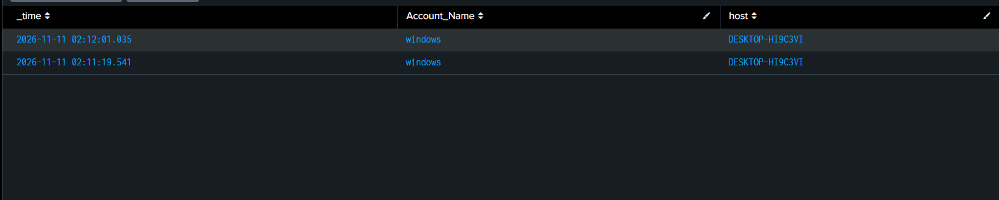

# Detection Practice 1.4: Security Audit Log Cleared (1102)

| | |
|---|---|
| **Type** | Detection search (not yet scheduled) |
| **Data source** | Windows Security log (1102), Windows System log (104) |
| **MITRE ATT&CK** | [T1070.001 Indicator Removal: Clear Windows Event Logs](https://attack.mitre.org/techniques/T1070/001/) |
| **Severity** | High |
| **Status** | ✅ Tested: 1102 found in Splunk after clearing the Security log on the Windows 10 VM |

## What it detects

After an attack, an attacker clears the Windows event logs to hide what they did (**defense evasion**).

| EventCode | Log | Meaning |
|---|---|---|
| 1102 | Security | The audit log was cleared |
| 104 | System | Another log (System, Application, ...) was cleared |

Windows cannot hide the fact that the log was cleared: **1102 is the first event written to the new, empty Security log**, and it records which account cleared it.

## Attack simulation

Run in an Administrator command prompt **on the lab VM only**:

```cmd
wevtutil cl Security
```

Other ways attackers do it: `Clear-EventLog -LogName Security` in PowerShell, or *Clear Log* in Event Viewer. All of them need admin rights.

## SPL

```spl
index=windows source="WinEventLog:Security" EventCode=1102
| table _time, Account_Name, host
```

To include other cleared logs (System log is already forwarded in `inputs.conf`):

```spl
index=windows (source="WinEventLog:Security" EventCode=1102) OR (source="WinEventLog:System" EventCode=104)
| table _time, host, source, EventCode, Account_Name
```

| Line | Why |
|---|---|
| `EventCode=1102` | Security log cleared |
| `EventCode=104` | Any other log cleared |
| `Account_Name` | Who cleared it. 1102 stores its data in a different XML section (`UserData`), so the field name can differ; if it is empty, open the raw event and look for e.g. `SubjectUserName` |

## Results

| _time | Account_Name | host |
|---|---|---|
| 2026-11-11 02:11:19.541 | windows | DESKTOP-HI9C3VI |
| 2026-11-11 02:12:01.035 | windows | DESKTOP-HI9C3VI |



**Findings:**
- The log was cleared **twice**, 42 seconds apart, and **each clear produced its own 1102**.
- `Account_Name` **was populated** (`windows`), so the account that cleared the log is visible without opening the raw event.
- The brute-force events from exercise 1.2 (00:44) are **still searchable in Splunk** after the Security log was cleared at 02:11: the forwarder had already sent them, so clearing the local log did not remove the copy in the SIEM.

## Analysis: why it is always High

- **Rarely legitimate:** admins almost never need to clear the Security log on a production host, so false positives are low.
- **Needs admin rights:** if it was not a planned admin action, the attacker already has high privileges.
- **Clear intent:** someone is trying to hide something, so other malicious activity probably happened before it.
- **Critical** on a domain controller or critical server, or when it follows the attack chain (1.2 → 1.3 → 1.5).

This is also the main argument for a SIEM: clearing the **local** log does not delete the copy already **indexed in Splunk**. The only gap is events not yet sent by the forwarder at the moment of clearing.

## Tuning ideas

- Save it as a real-time or frequent scheduled alert; this one is worth being woken up for.
- Also watch for attempts to **stop logging** instead of clearing it: audit policy changed (4719), EventLog service stopped (T1562.002).
