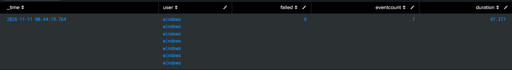

# Detection Practice 1.2: Brute Force Followed by a Successful Logon (4625 → 4624)

| | |
|---|---|
| **Type** | Detection search (not yet scheduled) |
| **Data source** | Windows Security log (`index=windows`, `source=WinEventLog:Security`) |
| **MITRE ATT&CK** | [T1110.001 Brute Force: Password Guessing](https://attack.mitre.org/techniques/T1110/001/) |
| **Severity** | High |
| **Status** | ✅ Tested: 6 failed logons followed by 1 success on the Windows 10 VM were detected |

## What it detects

More than 5 failed logons (4625) for the **same account**, ending with a **successful logon** (4624), within 10 minutes. This is a much stronger signal than failed logons alone: it means the guessing probably **worked** and the attacker may now be inside.

## Attack simulation

1. On the Windows 10 VM lock screen, typed a wrong password 6 times.
2. Logged in with the correct password on the 7th attempt.

## SPL

```spl
index=windows source="WinEventLog:Security" (EventCode=4624 OR EventCode=4625)
| eval user=lower(coalesce(mvindex(Account_Name,1), Account_Name))
| search user!="*$" user!="system" user!="dwm-*" user!="umfd-*" user!="anonymous logon"
| transaction user maxspan=10m endswith=eval(EventCode==4624) mvlist=true
| eval failed=mvcount(mvfilter(match(EventCode,"4625")))
| where failed > 5
| table _time user failed eventcount duration
```

| Line | Why |
|---|---|
| `mvindex(Account_Name,1)` | `Account_Name` is multivalue: index 0 is the **subject** (the machine, e.g. `DESKTOP-XXXX$`), index 1 is the **target** account that tried to log on |
| `coalesce(..., Account_Name)` | Fallback for events where `Account_Name` has only one value |
| `lower(...)` | `Windows` and `windows` must count as the same user |
| `search user!=...` | Drops machine accounts (`*$`) and built-in accounts that log on constantly in the background |
| `transaction user maxspan=10m` | Groups each user's events within 10 minutes |
| `endswith=eval(EventCode==4624)` | A successful logon closes the group |
| `mvlist=true` | Keeps every `EventCode` value (by default `transaction` removes duplicates, so six 4625s would become one) |
| `mvcount(mvfilter(match(EventCode,"4625")))` | Counts only the failures in the group |
| `where failed > 5` | Threshold |
| `duration` | Created by `transaction`: seconds from the first to the last event, shows how fast the attempts were |

## Results

| _time | user | failed | eventcount | duration |
|---|---|---|---|---|
| 2026-11-11 00:44:19 | windows | 6 | 7 | 47.377 s |



- 6 failures and 1 success in **47 seconds**, about one attempt every 8 seconds.
- `eventcount` is 7 (6 × 4625 + 1 × 4624). The success actually produced **two** 4624 events (see *Linked logon* below), but `endswith` closes the transaction at the first one, so the second falls outside the group.
- The same test also triggered the scheduled **[Multiple Failed Logons](multiple-failed-logons-4625.md)** alert at 00:45:00 UTC. That alert only says "many failures"; this search adds that the attacker **got in**.
- `user` is listed 7 times because `mvlist=true` keeps one value per event. Adding `| eval user=mvdedup(user)` before `table` shows it once.

## Iteration history

The original search from the exercise returned **nothing**, even though the events were in Splunk:

```spl
index=windows source="WinEventLog:Security" (EventCode=4624 OR EventCode=4625)
| transaction Account_Name maxspan=10m startswith=EventCode=4625 endswith=EventCode=4624
| where eventcount > 5
```

I debugged it pipe by pipe (`| table _time EventCode Account_Name` after each step):

| Problem | What I saw | Fix |
|---|---|---|
| Grouping on raw `Account_Name` | Every event had two values: `DESKTOP-XXXX$` and the target account. The shared machine name tied my logons to unrelated `SYSTEM`, `DWM-*` and `UMFD-*` logons | Group on `mvindex(Account_Name,1)` and filter out machine/system accounts |
| `startswith=EventCode=4625` | `startswith` does not mean "the group must begin with this"; it **opens a new transaction on every matching event**. Six 4625s produced several small groups instead of one | Removed `startswith`, kept `endswith` on 4624 |
| Linked logon | The success produced **two 4624 events** at the same millisecond, because the account is a local admin (Windows creates a filtered and an elevated token). Whether one or both land in a group depends on how the transaction is built | Count the 4625s with `mvfilter` + `mvcount` instead of trusting `eventcount` |
| `eventcount > 5` | Counts every event in the group including the 4624s, so it does not mean "more than 5 failures" | Same fix: count failures directly |

## Analysis

- **Severity High:** a successful logon right after repeated failures suggests the password was guessed.
- **Raise to Critical** if it is followed by account creation (4720), group changes (4732), persistence (7045/4698) or log clearing (1102) on the same host.
- **False positives:** a real user who forgot their password and finally got it right. Check the logon type, the time of day, and what the account did next.

## Tuning ideas

- `transaction` is expensive on large data. Rewrite with `stats` (e.g. `stats count(eval(EventCode==4625)) as failed, count(eval(EventCode==4624)) as success, earliest(_time), latest(_time) by user`) or `streamstats`.
- Compare the result with the CIM `user` field provided by the Splunk Add-on for Windows (the `eval` above overwrites it).
- Group by source IP (`Source_Network_Address`) as well, to catch **password spraying** (one source, many accounts).
- Save it as a scheduled alert.
