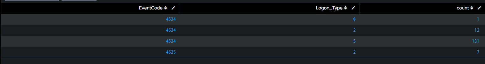

# Detection Practice 1.1: Logon Type Analysis (Event IDs 4624, 4625)

| | |
|---|---|
| **Type** | Baseline / hunting search (not scheduled) |
| **Data source** | Windows Security log (`index=windows`, `source=WinEventLog:Security`) |
| **MITRE ATT&CK** | [T1110 Brute Force](https://attack.mitre.org/techniques/T1110/), [T1021 Remote Services](https://attack.mitre.org/techniques/T1021/) |
| **Severity** | Informational (baseline) |
| **Status** | ✅ Run on normal lab activity |

## What it is for

Before hunting for attacks, I need to know what **normal** looks like. Every 4624 (success) and 4625 (failure) carries a `Logon_Type` that says **how** the logon happened. Knowing which types appear during normal lab activity makes an unusual one (for example RDP on a machine that never uses RDP) stand out.

| Logon_Type | Meaning | Typical source |
|---|---|---|
| 0 | System | Only used by the SYSTEM account at startup |
| 2 | Interactive | Keyboard at the machine / VM console |
| 3 | Network | SMB file share, `net use`, remote management |
| 4 | Batch | Scheduled tasks |
| 5 | Service | Services starting under a service account |
| 7 | Unlock | Unlocking the lock screen |
| 10 | RemoteInteractive | RDP |
| 11 | CachedInteractive | Logon with cached domain credentials |

## SPL

```spl
index=windows source="WinEventLog:Security" (EventCode=4624 OR EventCode=4625)
| stats count by EventCode, Logon_Type
```

| Line | Why |
|---|---|
| `(EventCode=4624 OR EventCode=4625)` | Successful and failed logons |
| `stats count by EventCode, Logon_Type` | One row per result/type combination, so successes and failures can be compared per type |

## Results

| EventCode | Logon_Type | count |
|---|---|---|
| 4624 | 0 | 1 |
| 4624 | 2 | 12 |
| 4624 | 5 | 131 |
| 4625 | 2 | 7 |



**Findings:**
- **Type 5 (Service) dominates** with 131 of 144 successful logons: services starting under SYSTEM and other service accounts. This is background noise, not people.
- **Type 2 (Interactive)** is the only type used by a human in this lab: 12 successful logons at the VM console.
- **Type 0** appeared once: the SYSTEM account at boot.
- **All 7 failed logons are type 2**: they came from the brute-force test typed at the VM console (6 attempts in exercise 1.2, plus one more mistyped password).
- **No type 3 (Network) or type 10 (RDP)** at all. On this host, any network or RDP logon, and especially a failed one, would be unusual and worth investigating.

## Analysis

- Most 4624 events on a workstation come from **SYSTEM and service accounts** (type 5) and are noise for a SOC analyst. Filtering out machine accounts (`*$`) and built-in accounts makes the human logons visible.
- A failure type tells **where** an attack comes from: type 2 = someone at the keyboard, type 3 = over the network (SMB), type 10 = RDP brute force.

## Tuning ideas

- Add the account to see who uses which type: `stats count by EventCode, Logon_Type, user`.
- Turn this baseline into an alert for logon types that never appear normally (e.g. type 10 on this host).
