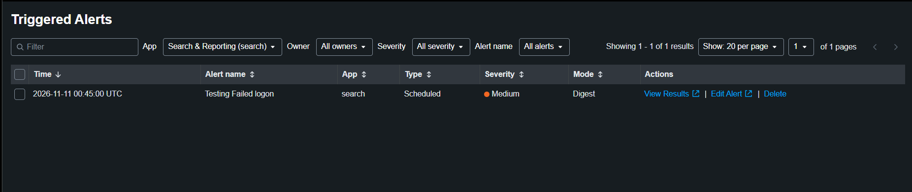

# Detection: Multiple Failed Logons (Event ID 4625)

| | |
|---|---|
| **Alert name** | Testing Failed logon |
| **Data source** | Windows Security log (`index=windows`, `source=WinEventLog:Security`) |
| **MITRE ATT&CK** | [T1110 Brute Force](https://attack.mitre.org/techniques/T1110/) |
| **Severity** | Medium |
| **Status** | ✅ Tested: triggered on schedule after 6+ failed logons on the Windows 10 VM |

## What it detects

Five or more failed logons (Event ID 4625) against the **same account** within a 5-minute window, a common sign of password guessing or brute force.

## SPL

```spl
index=windows source="wineventlog:security" EventCode=4625
| eval target_user=mvindex(Account_Name, -1)
| bin _time span=5m
| stats count as failures values(Logon_Type) as logon_types values(Workstation_Name) as source_hosts by _time, target_user
| where failures >= 5
```

| Line | Why |
|---|---|
| `EventCode=4625` | Only failed logons |
| `mvindex(Account_Name, -1)` | A 4625 event has two `Account_Name` values: the subject that requested the logon (often `-`) and the account that failed. The last one is the target |
| `bin _time span=5m` + `stats ... by _time, target_user` | Count failures per account per 5-minute window |
| `logon_types`, `source_hosts` | Triage context: interactive (2), network (3), RDP (10), and where the attempts came from |
| `where failures >= 5` | Threshold |

## Alert settings

| Setting | Value |
|---|---|
| Schedule | Cron `*/5 * * * *` (every 5 minutes) |
| Time range | `-5m@m` to `@m` |
| Trigger | Number of results > 0 |
| Mode | Digest (one alert per run) |
| Action | Add to Triggered Alerts |

## Iteration history

The first version looked like it worked but would not have caught a real attack:

| Problem in v1 | Impact | Fix in v2 |
|---|---|---|
| No `EventCode=4625` filter | Counted **every** Security event (successful logons, logoffs...), so it fired on normal activity | Filter on 4625 only |
| `cron_schedule = 0 6 * * 1` with a 5-minute window | Ran once a week (Monday 06:00) and only looked at 5 minutes: brute force at any other time was missed | Run every 5 minutes, matching the window |
| Grouped by raw `Account_Name` | Mixed the requesting subject with the target account | `mvindex(Account_Name, -1)` |

## Testing

1. Right after a 5-minute boundary, typed a wrong password 6–7 times on the Windows 10 VM.
2. Confirmed the events in Splunk: `index=windows EventCode=4625 earliest=-15m`.
3. Waited for the next scheduled run and checked **Activity → Triggered Alerts**.



## Tuning ideas

- Lower the threshold or widen the window for slow, low-volume guessing.
- Add a separate alert for **4625 followed by 4624** on the same account (failed attempts, then a success).
- Alert on many different accounts failing from one source (password spraying).
