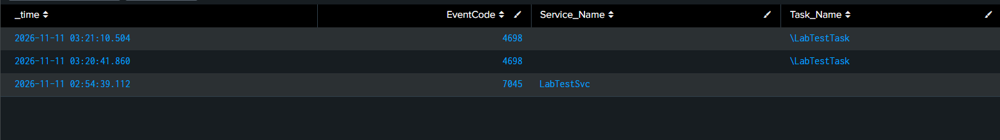

# Detection Practice 1.5: New Service and Scheduled Task (7045, 4698)

| | |
|---|---|
| **Type** | Detection search (not yet scheduled) |
| **Data source** | Windows System log (7045), Windows Security log (4698) |
| **MITRE ATT&CK** | [T1543.003 Create or Modify System Process: Windows Service](https://attack.mitre.org/techniques/T1543/003/), [T1053.005 Scheduled Task/Job: Scheduled Task](https://attack.mitre.org/techniques/T1053/005/) |
| **Severity** | Medium (raised when the path or command is suspicious) |
| **Status** | ✅ Tested: both events found after creating a test service and a test scheduled task |

## What it detects

Two common ways to get **persistence**: make malware start again automatically after a reboot or logon.

| EventCode | Log | Meaning | Audit policy needed |
|---|---|---|---|
| 7045 | System | A new service was installed | No, logged by default |
| 4698 | Security | A scheduled task was created | Yes: *Other Object Access Events* |
| 4699 | Security | A scheduled task was deleted | Yes: *Other Object Access Events* |

Services usually run as **SYSTEM**, and tasks can be set to run as SYSTEM too, so both can also give privilege escalation. 4698 contains the **full XML of the task**, including the command it runs and its trigger.

## Attack simulation

Run in an Administrator command prompt on the Windows 10 VM:

```cmd
sc.exe create LabTestSvc binPath= "C:\Windows\System32\notepad.exe"
schtasks /create /tn LabTestTask /tr notepad.exe /sc once /st 23:59
```

Cleanup (deleting the task also logs 4699):

```cmd
sc.exe delete LabTestSvc
schtasks /delete /tn LabTestTask /f
```

## SPL

```spl
index=windows ((source="WinEventLog:System" EventCode=7045) OR (source="WinEventLog:Security" EventCode=4698))
| table _time, EventCode, Service_Name, Task_Name
```

| Line | Why |
|---|---|
| `source="WinEventLog:System" EventCode=7045` | 7045 is in the **System** log, not Security |
| `source="WinEventLog:Security" EventCode=4698` | Scheduled task created |
| `Service_Name`, `Task_Name` | What was created; for triage also look at the service path (`Service_File_Name` / ImagePath) and the task's command in its XML content |

## Results

| _time | EventCode | Service_Name | Task_Name |
|---|---|---|---|
| 2026-11-11 02:54:39.112 | 7045 | LabTestSvc | |
| 2026-11-11 03:20:41.860 | 4698 | | \LabTestTask |
| 2026-11-11 03:21:10.504 | 4698 | | \LabTestTask |



- **7045** appeared right away: the System log needs no extra audit policy.
- The **4698** events only appear about 26 minutes later, after *Other Object Access Events* was enabled and the task was recreated (see the iteration history). The task was created twice during testing, so there are two 4698 events.
- The leading `\` in `\LabTestTask` is the task's folder path: it sits in the root of Task Scheduler.

## Iteration history

| Problem | Cause | Fix |
|---|---|---|
| 7045 appeared in Splunk, but **4698 did not** | 7045 is logged by default, but 4698 needs the *Other Object Access Events* audit subcategory, which was off | `auditpol /set /subcategory:"Other Object Access Events" /success:enable` |
| Still no 4698 for the existing task | Audit policy is **not retroactive**: the task was created before auditing was enabled | Deleted and recreated the task; 4699 (delete) and 4698 (create) both appeared |

## Analysis

- **Medium by default:** legitimate software creates services and tasks all the time (browser updaters, antivirus, drivers), so this is noisy.
- **Raise to High/Critical** when:
  - the path is in a user or temp folder (`C:\Users\...`, `C:\Users\Public`, `AppData`, `C:\Temp`);
  - the command uses `cmd.exe /c` or `powershell -enc`;
  - it runs as SYSTEM with a logon/startup trigger;
  - the name is random or imitates a legitimate one (`WindowsUpdateSvc`, `OneDriveUpdate`);
  - a `PSEXESVC` service appears on a host that should not be managed remotely (PsExec lateral movement);
  - it follows the attack chain (1.2 → 1.3) on the same host.

## Tuning ideas

- Keep an **allowlist** of known services and tasks so analysts are not flooded with false positives.
- Search the 4698 task XML and the 7045 service path for suspicious folders and keywords.
- Add 4697 (service installed, Security log; needs *Security System Extension*) and 4702 (task updated).
