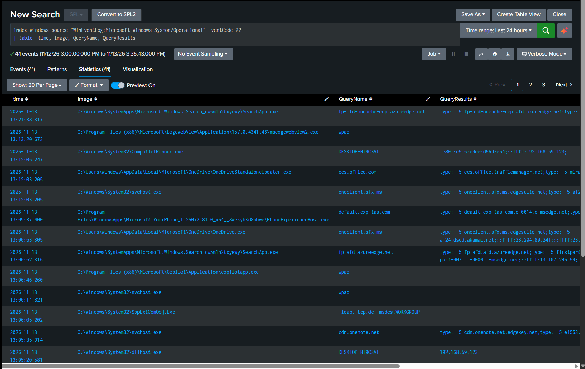

# Detection Practice 2.4: DNS Queries per Process (Sysmon 22)

| | |
|---|---|
| **Type** | Hunting search (not an alert) |
| **Data source** | Sysmon Event ID 22 (DNS Query) |
| **MITRE ATT&CK** | [T1071.004 Application Layer Protocol: DNS](https://attack.mitre.org/techniques/T1071/004/), [T1568 Dynamic Resolution](https://attack.mitre.org/techniques/T1568/) |
| **Severity** | Informational |
| **Status** | ✅ Tested: 41 DNS query events (last 24 hours); field extraction fixed with the Splunk Add-on for Sysmon |

## What it does

Before a program can reach `example.com` it has to ask DNS for the address, so DNS is the earliest trace of almost any network activity. Event ID 22 records **which process asked for which name, and what the answer was**.

| Field | Meaning |
|---|---|
| `Image` | Process that made the query |
| `QueryName` | Name that was asked for |
| `QueryResults` | The answer (aliases and IP addresses) |
| `QueryStatus` | `0` = success, anything else = failure |

It complements [2.3](sysmon-network-connections-eid3.md): Event ID 3 shows only a destination IP, Event ID 22 gives it a name.

| Technique | What it looks like in DNS |
|---|---|
| T1071.004 DNS | DNS used as the channel itself: data hidden in long random subdomains (DNS tunneling) |
| T1568 Dynamic Resolution | No fixed C2 address; e.g. a DGA generates many random domains and tries them until one answers |

## SPL

```spl
index=windows source="WinEventLog:Microsoft-Windows-Sysmon/Operational" EventCode=22
| table _time, Image, QueryName, QueryResults
```

After the switch to XML (see below), with the status added:

```spl
index=windows source="XmlWinEventLog:Microsoft-Windows-Sysmon/Operational" EventCode=22
| table _time, Image, QueryName, QueryStatus, QueryResults
```

To generate a test event, use a command that goes through the Windows DNS Client service:

```powershell
Resolve-DnsName tryhackme.com
```

> `nslookup` is not a good test: it sends its question straight to the DNS server and bypasses the DNS Client service that Sysmon logs from, so it produces no Event ID 22. The SwiftOnSecurity config also drops many common domains, so pick an uncommon one.

## Results

A selection of the 41 events (times are UTC):

| _time | Image | QueryName | QueryResults |
|---|---|---|---|
| 13:21:38 | `...\Microsoft.Windows.Search_...\SearchApp.exe` | `fp-afd-nocache-ccp.azureedge.net` | `type: 5 fp-afd-nocache-ccp.afd.azureedge.net;...` |
| 13:13:20 | `...\EdgeWebView\...\msedgewebview2.exe` | `wpad` | `-` |
| 13:12:05 | `C:\Windows\System32\CompatTelRunner.exe` | `DESKTOP-HI9C3VI` | `fe80::...;::ffff:192.168.59.123;` |
| 13:12:03 | `...\OneDrive\OneDriveStandaloneUpdater.exe` | `ecs.office.com` | `type: 5 ecs.office.trafficmanager.net;...` |
| 13:06:53 | `...\OneDrive\OneDrive.exe` | `oneclient.sfx.ms` | `type: 5 oneclient.sfx.ms.edgesuite.net;type: 5 a124.dscd.akamai.net;::ffff:23.204.80.241;...` |
| 13:06:14 | `C:\Windows\System32\svchost.exe` | `wpad` | `-` |
| 13:06:05 | `C:\Windows\System32\SppExtComObj.Exe` | `_ldap._tcp.dc._msdcs.WORKGROUP` | `-` |



**How to read `QueryResults`.** The answers are listed in order, separated by semicolons, following the chain from the name that was asked to the final address. Example from `BackgroundTransferHost.exe`:

```
type: 5 res-1.public.onecdn.static.microsoft;type: 5 res-ocdi-stls-prod.edgesuite.net;::ffff:23.39.173.24;::ffff:23.39.173.33;...
```

| Part | Meaning |
|---|---|
| `type: 5 <name>` | A **CNAME** record: the name is an alias for `<name>` |
| `::ffff:23.39.173.24` | An IPv4 address written in IPv6 form; the real address is `23.39.173.24` |

So: queried name → Microsoft alias → `edgesuite.net` (Akamai CDN) alias → several CDN server IPs. In Event ID 3 this would only have been an anonymous `23.39.173.x` address.

**Findings:**
- Almost all queries are **Windows and Microsoft components** (Search, OneDrive, Edge WebView, telemetry) asking for Microsoft and CDN domains. This is the DNS baseline for the VM.
- **`wpad`** is queried by several processes and always fails. It is Web Proxy Auto-Discovery; there is no such host in the lab, so no answer is expected.
- **`_ldap._tcp.dc._msdcs.WORKGROUP`** is Windows looking for a domain controller. The VM is in a workgroup, not a domain, so it also gets no answer.
- The VM's own name **`DESKTOP-HI9C3VI`** resolves to `192.168.59.123`.

## Analysis: an empty result is still a query

`QueryResults` = `-` does **not** mean the process skipped DNS. The event only exists because the question was asked; `-` means there was no answer to record. `QueryStatus` says why:

| QueryStatus | Meaning |
|---|---|
| `0` | Success |
| `123` | Invalid name: the string is not a valid DNS name (seen in this lab) |
| `9003` | Name does not exist (NXDOMAIN) |
| `9501` | Name exists but has no record of the requested type (common for IPv6 lookups) |
| `1460` | Timeout: the DNS server did not answer |

Failed queries are a signal of their own: one process asking for many random names that all fail is the classic DGA pattern.

**What would not fit this baseline:**

| Pattern | Possible meaning |
|---|---|
| Very long, random-looking subdomains | DNS tunneling |
| One process querying many different subdomains of one domain | DNS tunneling |
| Many random domains with failing `QueryStatus` | DGA searching for a live domain |
| `notepad.exe`, `rundll32.exe`, `powershell.exe` making queries | A process that should not need the Internet |
| The same domain queried at a fixed interval | Beaconing |

## Field extraction problem and fix

With the Sysmon input in the classic text format, `QueryResults` was visible in the raw event but came up **empty in `table`** for events with `QueryStatus` 0. The value is full of colons and semicolons, and the generic Windows add-on did not extract it reliably.

Fix: installed the **Splunk Add-on for Sysmon** on the Splunk server and switched the forwarder input to XML (`renderXml = 1`, see [`forwarder/inputs.conf`](../forwarder/inputs.conf)). Side effects: the source name changed to `XmlWinEventLog:Microsoft-Windows-Sysmon/Operational`, and events indexed before the switch stay under the old source.

A search-time workaround that needs no add-on:

```spl
... EventCode=22
| rex "QueryResults: (?<dns_results>[^\r\n]+)"
| table _time, Image, QueryName, QueryStatus, dns_results
```

## Tuning ideas

- Baseline with `| stats count by Image, QueryName` instead of a raw table.
- `| stats dc(QueryName) by Image` to find processes that query unusually many names.
- `| eval len=len(QueryName) | where len > 50` as a simple tunneling check.
