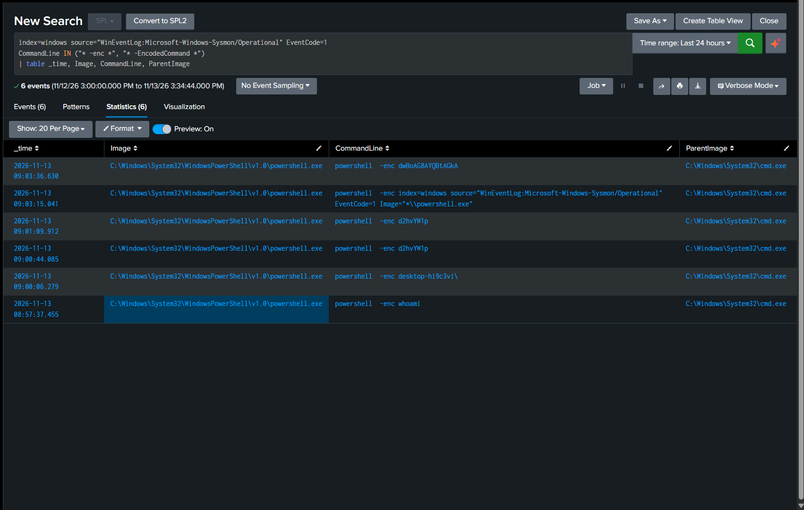

# Detection Practice 2.2: Encoded PowerShell (Sysmon 1)

| | |
|---|---|
| **Type** | Detection search (not yet scheduled) |
| **Data source** | Sysmon Event ID 1 (Process Creation), `CommandLine` field |
| **MITRE ATT&CK** | [T1059.001 PowerShell](https://attack.mitre.org/techniques/T1059/001/), [T1027.010 Command Obfuscation](https://attack.mitre.org/techniques/T1027/010/) |
| **Severity** | Medium |
| **Status** | ✅ Tested: 6 `powershell -enc` executions found in Splunk, including the failed attempts |

## What it detects

Attackers hide PowerShell commands by Base64-encoding them and passing them with `-EncodedCommand` (short form `-enc`). The command is no longer readable in the log, and keyword rules looking for e.g. `DownloadString` miss it.

One event maps to two techniques because it shows two things:

| Technique | Tactic | Evidence in the event |
|---|---|---|
| T1059.001 PowerShell | Execution | `Image` is `powershell.exe` |
| T1027.010 Command Obfuscation | Defense Evasion | `-enc` plus a Base64 string in `CommandLine` |

## Attack simulation

A harmless command (`whoami`), encoded and run from `cmd.exe` on the lab VM.

PowerShell expects the text to be encoded as **UTF-16LE** before Base64. Building the string in PowerShell itself avoids mistakes:

```powershell
$cmd = 'whoami'
$b64 = [Convert]::ToBase64String([Text.Encoding]::Unicode.GetBytes($cmd))
$b64                      # dwBoAG8AYQBtAGkA
powershell -enc $b64
```

## SPL

```spl
index=windows source="WinEventLog:Microsoft-Windows-Sysmon/Operational" EventCode=1
CommandLine IN ("* -enc *", "* -EncodedCommand *")
| table _time, Image, CommandLine, ParentImage
```

> This search was run before the Sysmon input was switched to XML. After the switch, use `source="XmlWinEventLog:Microsoft-Windows-Sysmon/Operational"`.

| Line | Why |
|---|---|
| `EventCode=1` | Process creation, the only event that carries the full `CommandLine` |
| `CommandLine IN (...)` | Matches the two most common spellings of the flag |
| `ParentImage` | Who launched PowerShell; needed to judge the result |

## Results

Times are UTC. All six events have `Image` = `...\WindowsPowerShell\v1.0\powershell.exe` and `ParentImage` = `C:\Windows\System32\cmd.exe`.

| _time | CommandLine | What happened |
|---|---|---|
| 2026-11-13 08:57:37 | `powershell -enc whoami` | Plain text, not Base64: PowerShell rejects it |
| 2026-11-13 09:00:44 | `powershell -enc d2hvYW1p` | Base64 of **UTF-8** `whoami`: rejected |
| 2026-11-13 09:01:09 | `powershell -enc d2hvYW1p` | Same again |
| 2026-11-13 09:03:36 | `powershell -enc dwBoAG8AYQBtAGkA` | Base64 of **UTF-16LE** `whoami`: runs |

The other two events are mistyped attempts (pasted text after `-enc`); they are visible in the screenshot.



**Findings:**
- **Every attempt was logged, including the ones that failed.** Sysmon records the process start, not whether the payload was valid, so the detection fires on the flag itself.
- My first Base64 string was wrong because online encoders and `base64` on Linux use UTF-8. PowerShell needs UTF-16LE:

  | Encoding | `whoami` becomes | Accepted by `-enc` |
  |---|---|---|
  | UTF-8 | `d2hvYW1p` | No |
  | UTF-16LE | `dwBoAG8AYQBtAGkA` | Yes |

- UTF-16LE puts a zero byte after every ASCII character, which shows up in Base64 as a repeating **`A`** pattern (`dwBoAG8AYQ...`). That pattern is a quick visual clue for encoded PowerShell.
- The parent was `cmd.exe` because I typed the command there. In a real case the parent is the most important context.

## Analysis

Encoding alone is not proof of an attack: some installers and admin tools also use `-enc`. A hit is a starting point for investigation:

1. **Decode it** to see the real command:
   ```powershell
   [Text.Encoding]::Unicode.GetString([Convert]::FromBase64String('dwBoAG8AYQBtAGkA'))
   ```
2. **Check the parent.** `explorer.exe` or `cmd.exe` opened by a user is one thing; `winword.exe`, `wscript.exe` or a service is another.
3. **Look at what the process did next** (network, DNS, files) using the other Sysmon events in exercises 2.3 to 2.6.

> Update: with PowerShell Script Block Logging enabled, Event ID 4104 records the command already decoded, so step 1 no longer has to be done by hand. See [`docs/log-visibility.md`](../docs/log-visibility.md).

Raise to **High** when the parent is an Office application or script host, or when the decoded command downloads or executes something.

## Tuning ideas

- PowerShell accepts any unambiguous prefix of the flag (`-e`, `-ec`, `-en`, `-enc`, ...), which the `IN` list above misses. A `regex` version to cover them (**not yet tested in the lab**):
  ```spl
  index=windows source="XmlWinEventLog:Microsoft-Windows-Sysmon/Operational" EventCode=1 Image="*\\powershell.exe"
  | regex CommandLine="(?i)\s-e(c|n[codemand]*)?\s+\S+"
  | table _time, Image, CommandLine, ParentImage
  ```
- Add `pwsh.exe` (PowerShell 7) to the `Image` filter.
- Exclude known-good parents once they are identified, instead of excluding by command content.
