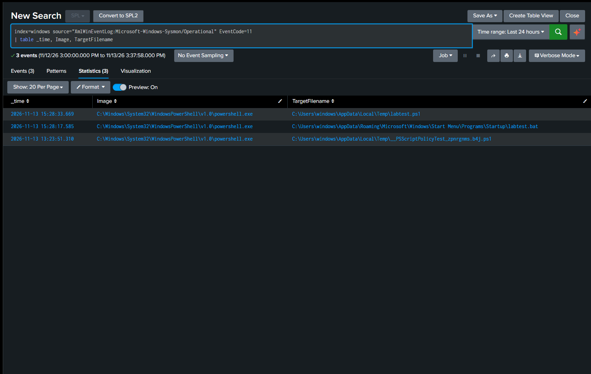

# Detection Practice 2.6: File Creation (Sysmon 11)

| | |
|---|---|
| **Type** | Detection / hunting search (not yet scheduled) |
| **Data source** | Sysmon Event ID 11 (File Create) |
| **MITRE ATT&CK** | [T1105 Ingress Tool Transfer](https://attack.mitre.org/techniques/T1105/), [T1547.001 Registry Run Keys / Startup Folder](https://attack.mitre.org/techniques/T1547/001/) |
| **Severity** | Low (Medium for the Startup folder) |
| **Status** | ✅ Tested: both test files found in Splunk (Startup folder and Temp) |

## What it detects

Event ID 11 records a file being created or overwritten, and the process that did it.

| Field | Meaning |
|---|---|
| `Image` | Process that created the file |
| `TargetFilename` | Full path of the new file |

After getting in, attackers download more tools onto the host (T1105), and every download ends up as a new file on disk. The **Startup folder** is the second half of T1547.001: anything placed there runs at logon, like a Run key ([2.5](sysmon-run-key-persistence-eid13.md)) but without touching the registry.

## Attack simulation

On the lab VM, from PowerShell: one file in the Startup folder and one script in Temp.

```powershell
Set-Content "$env:APPDATA\Microsoft\Windows\Start Menu\Programs\Startup\labtest.bat" "echo test"
Set-Content "$env:TEMP\labtest.ps1" "whoami"
```

Clean-up afterwards:

```powershell
Remove-Item "$env:APPDATA\Microsoft\Windows\Start Menu\Programs\Startup\labtest.bat"
Remove-Item "$env:TEMP\labtest.ps1"
```

## SPL

```spl
index=windows source="XmlWinEventLog:Microsoft-Windows-Sysmon/Operational" EventCode=11
| table _time, Image, TargetFilename
```

## Results

Times are UTC. `Image` is `C:\Windows\System32\WindowsPowerShell\v1.0\powershell.exe` for all three.

| _time | TargetFilename |
|---|---|
| 2026-11-13 13:23:51.310 | `C:\Users\windows\AppData\Local\Temp\__PSScriptPolicyTest_zpnrgnms.b4j.ps1` |
| 2026-11-13 15:28:17.585 | `C:\Users\windows\AppData\Roaming\Microsoft\Windows\Start Menu\Programs\Startup\labtest.bat` |
| 2026-11-13 15:28:33.669 | `C:\Users\windows\AppData\Local\Temp\labtest.ps1` |



**Findings:**
- **Both test files were logged**, with `powershell.exe` as the creator because they were written with `Set-Content`.
- There is a **third file I did not create**: `__PSScriptPolicyTest_<random>.ps1` in Temp. PowerShell writes this small test script itself when a session starts, to check the script execution policy. It is normal noise and belongs in the baseline, but it is a good example of how a random-looking `.ps1` in Temp is not automatically malicious.
- Only **3 events in 24 hours**: the SwiftOnSecurity config logs file creation only for selected locations and file types (e.g. Startup, scripts and executables). A plain `.txt` on the Desktop would most likely not appear, which is a blind spot to remember, not an error.

## Analysis

| Look at | Expected | Suspicious |
|---|---|---|
| `TargetFilename` (where) | `Program Files`, an application's own folders | `Temp`, `AppData`, `Public`, `ProgramData`, **Startup** |
| File type | Fits what the program does | Executable or script (`.exe`, `.dll`, `.ps1`, `.bat`, `.vbs`) in a temporary folder |
| `Image` (who) | An installer, a browser saving a user's download | `powershell.exe`, `certutil.exe`, `bitsadmin.exe`, `mshta.exe`, an Office application |

`certutil.exe` and `bitsadmin.exe` are built-in Windows tools often misused to download files, because their presence raises no suspicion.

A new file in the **Startup folder** written by a scripting tool, like `labtest.bat` here, is the pattern worth alerting on (Medium).

## How the Sysmon exercises fit together

The six exercises follow one process through an attack, each step leaving a different event:

```
Encoded PowerShell     DNS query          Connection         File dropped        Persistence
Event 1            ──► Event 22       ──► Event 3        ──► Event 11        ──► Event 13
(T1059.001, T1027)     (T1071.004)        (T1071)            (T1105)             (T1547.001)
```

The link between them is **`ProcessGuid`**, a unique ID for one process that appears in every Sysmon event type. Searching for one `ProcessGuid` returns everything that process did.

## Tuning ideas

- Narrow the search to the Startup folder for an alert: `TargetFilename="*\\Start Menu\\Programs\\Startup\\*"`.
- Exclude `__PSScriptPolicyTest_*` to remove the PowerShell start-up noise.
- Correlate with Event ID 1 and 3 by `ProcessGuid` to see whether the process that wrote the file also downloaded it.
