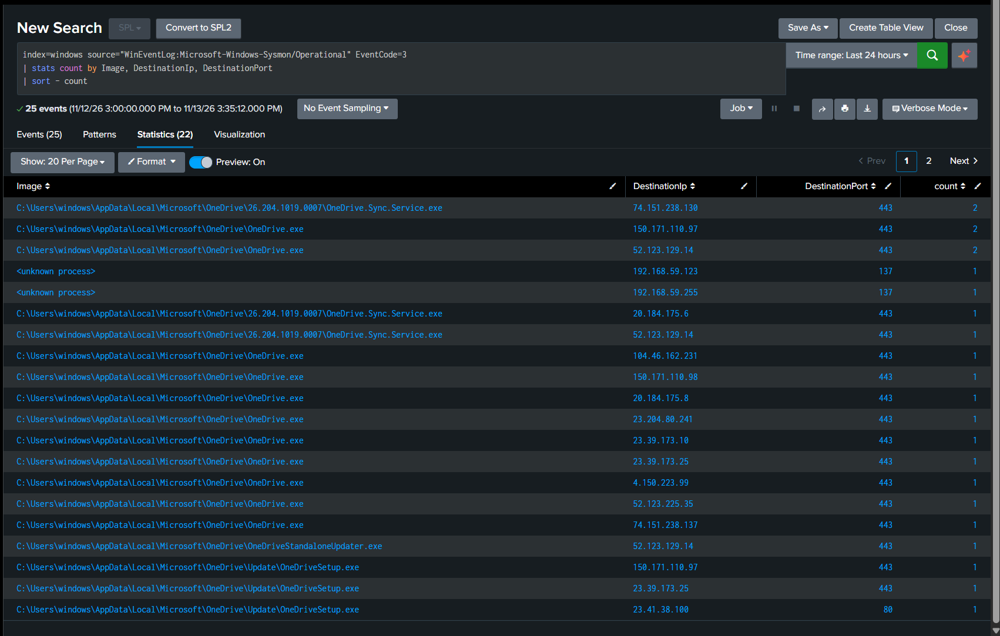

# Detection Practice 2.3: Network Connections per Process (Sysmon 3)

| | |
|---|---|
| **Type** | Hunting search (not an alert) |
| **Data source** | Sysmon Event ID 3 (Network Connection) |
| **MITRE ATT&CK** | [T1071 Application Layer Protocol](https://attack.mitre.org/techniques/T1071/) |
| **Severity** | Informational |
| **Status** | ✅ Tested: 25 connection events (last 24 hours) grouped by process and destination |

## What it does

A firewall knows that IP A talked to IP B. Sysmon Event ID 3 adds **which process** opened the connection.

| Field | Meaning |
|---|---|
| `Image` | Process that opened the connection |
| `SourceIp`, `SourcePort` | Where it came from |
| `DestinationIp`, `DestinationPort` | Where it went |
| `Protocol` | `tcp` or `udp` |
| `Initiated` | `true` if this host started the connection |

Malware that needs to reach its command-and-control server usually hides in common protocols (HTTP/HTTPS, DNS), so the port looks normal. The clue is the process: `chrome.exe` to port 443 is expected, `notepad.exe` or `rundll32.exe` to port 443 on an unknown public IP is not.

## SPL

```spl
index=windows source="WinEventLog:Microsoft-Windows-Sysmon/Operational" EventCode=3
| stats count by Image, DestinationIp, DestinationPort
| sort - count
```

> This search was run before the Sysmon input was switched to XML. After the switch, use `source="XmlWinEventLog:Microsoft-Windows-Sysmon/Operational"`.

## Results

25 events, 22 distinct process/destination combinations. Summarised by process:

| Image | Destination | Port |
|---|---|---|
| `C:\Users\windows\AppData\Local\Microsoft\OneDrive\OneDrive.exe` | Many public IPs (e.g. `150.171.110.97`, `52.123.129.14`, `23.39.173.10`) | 443 |
| `...\OneDrive\26.204.1019.0007\OneDrive.Sync.Service.exe` | `74.151.238.130`, `20.184.175.6`, `52.123.129.14` | 443 |
| `...\OneDrive\OneDriveStandaloneUpdater.exe` | `52.123.129.14` | 443 |
| `...\OneDrive\Update\OneDriveSetup.exe` | `150.171.110.97`, `23.39.173.25` | 443 |
| `...\OneDrive\Update\OneDriveSetup.exe` | `23.41.38.100` | **80** |
| `<unknown process>` | `192.168.59.123` | **137** |
| `<unknown process>` | `192.168.59.255` | **137** |



**Findings:**
- **Every named process is OneDrive**, syncing and updating itself over HTTPS. It is legitimate here, but note where it runs from: `C:\Users\...\AppData\Local`, a **user-writable path**, which is also where malware typically lives. The path alone cannot be the detection.
- Only **25 events in 24 hours**: the SwiftOnSecurity config logs network connections selectively, so this is not the VM's full traffic. A process missing from this list has not necessarily been silent.
- One connection used **port 80** (`OneDriveSetup.exe`), the only plain-HTTP connection to the Internet in the results.
- Two events have `Image` = **`<unknown process>`** on **port 137** (NetBIOS Name Service):
  - `192.168.59.255` is the subnet broadcast address.
  - `192.168.59.123` is this VM's own address (confirmed in [2.4](sysmon-dns-queries-eid22.md), where the hostname resolves to it).
  - Both stay inside the lab network, which is what NetBIOS name lookups should do.

## Analysis

**The port 137 events.** NetBIOS name resolution is handled by Windows itself rather than by an ordinary `.exe`, which is the likely reason Sysmon has no image path to show. Still to confirm on the raw events: `ProcessId` (4 would mean the System process), `Protocol` (expected `udp`) and `Initiated`.

It would be suspicious if the destination were a **public IP**: NetBIOS has no reason to leave the local network. The protocol is also abusable from inside: because the question is broadcast to every host, an attacker on the same network can answer falsely and capture password hashes ([T1557.001 LLMNR/NBT-NS Poisoning](https://attack.mitre.org/techniques/T1557/001/)).

**What would not fit this baseline:**

| Pattern | Why it stands out |
|---|---|
| `powershell.exe`, `rundll32.exe`, `mshta.exe`, `notepad.exe` connecting to a public IP | Processes that normally have no reason to talk to the Internet |
| A new executable under `AppData` or `Temp` making connections | Same location as OneDrive, but not OneDrive |
| Connections at a fixed interval to one IP | Beaconing to a C2 server |
| Unusual ports (4444, 8080, 1337, ...) | Common defaults of attack tools |

## Tuning ideas

- Add `Initiated`, `Protocol` and `SourceIp` to the `stats` to tell inbound from outbound.
- Split private from public destinations with `cidrmatch`, so Internet traffic can be reviewed on its own.
- Combine with Event ID 22 ([2.4](sysmon-dns-queries-eid22.md)) to turn destination IPs into domain names.
