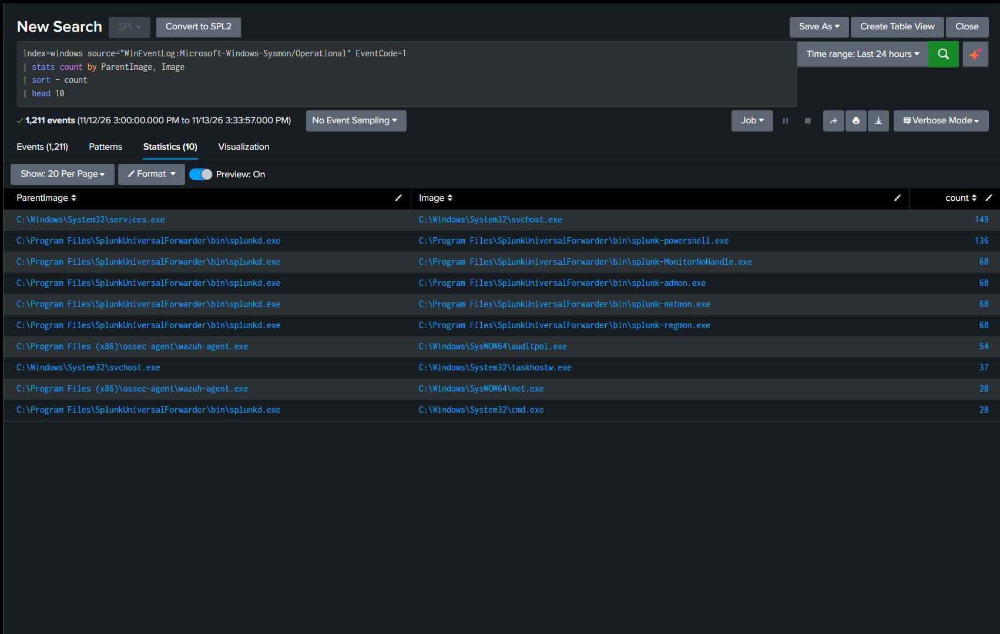

# Detection Practice 2.1: Baseline Process Creation (Sysmon 1)

| | |
|---|---|
| **Type** | Baseline / hunting search (not an alert) |
| **Data source** | Sysmon Event ID 1 (Process Creation) |
| **MITRE ATT&CK** | [T1059 Command and Scripting Interpreter](https://attack.mitre.org/techniques/T1059/) |
| **Severity** | Informational |
| **Status** | ✅ Tested: baseline built from 1,211 process-creation events (last 24 hours) on the Windows 10 VM |

## What it does

Sysmon Event ID 1 records every new process with two key fields:

| Field | Meaning |
|---|---|
| `Image` | Full path of the executable that was started |
| `ParentImage` | Full path of the process that started it |

A process name alone is rarely suspicious: `powershell.exe` and `cmd.exe` are used by admins, software and attackers alike. The **parent → child pair** is what separates them. This search answers "what does normal look like on this VM?", so that later detections have something to compare against.

## SPL

```spl
index=windows source="WinEventLog:Microsoft-Windows-Sysmon/Operational" EventCode=1
| stats count by ParentImage, Image
| sort - count
| head 10
```

> This search was run before the Sysmon input was switched to XML. After the switch, use `source="XmlWinEventLog:Microsoft-Windows-Sysmon/Operational"` (see the [README](../README.md#-troubleshooting-log)).

## Results

| ParentImage | Image | count |
|---|---|---|
| `C:\Windows\System32\services.exe` | `C:\Windows\System32\svchost.exe` | 149 |
| `...\SplunkUniversalForwarder\bin\splunkd.exe` | `...\bin\splunk-powershell.exe` | 136 |
| `...\SplunkUniversalForwarder\bin\splunkd.exe` | `...\bin\splunk-MonitorNoHandle.exe` | 68 |
| `...\SplunkUniversalForwarder\bin\splunkd.exe` | `...\bin\splunk-admon.exe` | 68 |
| `...\SplunkUniversalForwarder\bin\splunkd.exe` | `...\bin\splunk-netmon.exe` | 68 |
| `...\SplunkUniversalForwarder\bin\splunkd.exe` | `...\bin\splunk-regmon.exe` | 68 |
| `C:\Program Files (x86)\ossec-agent\wazuh-agent.exe` | `C:\Windows\SysWOW64\auditpol.exe` | 54 |
| `C:\Windows\System32\svchost.exe` | `C:\Windows\System32\taskhostw.exe` | 37 |
| `C:\Program Files (x86)\ossec-agent\wazuh-agent.exe` | `C:\Windows\SysWOW64\net.exe` | 28 |
| `...\SplunkUniversalForwarder\bin\splunkd.exe` | `C:\Windows\System32\cmd.exe` | 28 |



Each row is one edge of the process tree. Joined together they give the tree for this VM:

```
services.exe
├─ svchost.exe (149)
│  └─ taskhostw.exe (37)
├─ splunkd.exe
│  ├─ splunk-powershell.exe (136)
│  ├─ splunk-MonitorNoHandle / admon / netmon / regmon (68 each)
│  └─ cmd.exe (28)
└─ wazuh-agent.exe
   ├─ auditpol.exe (54)
   └─ net.exe (28)
```

**Findings:**
- The whole top 10 sits on the **service branch** (`services.exe` and its children). The user branch (`explorer.exe` → applications) does not appear, which fits a lab VM that is rarely used interactively.
- The **noisiest processes are the security tools themselves**: the Splunk Universal Forwarder and the Wazuh agent left over from my earlier Wazuh lab.
- The four forwarder helpers have the **same count (68)**, which suggests `splunkd.exe` launches them together.
- The Wazuh agent is a 32-bit program (`Program Files (x86)`), so it calls the 32-bit copies of `auditpol.exe` and `net.exe` in `SysWOW64`.
- The SwiftOnSecurity config excludes many noisy processes, so this is "normal as recorded by Sysmon", not a list of every process.

## Analysis: why the parent matters

`net.exe` and `auditpol.exe` are also attacker tools: `net` to list users and groups (discovery), `auditpol` to switch auditing off (defense evasion). On this VM both are normal **when the parent is `wazuh-agent.exe`**. The same binaries started by `cmd.exe` or `powershell.exe` would deserve a closer look.

ATT&CK describes behaviour, not intent: `splunkd.exe → cmd.exe` is technically T1059.003 (Windows Command Shell) and still legitimate here. The baseline is what tells the two apart.

Pairs that would **not** fit this baseline:

| Pair | Why it stands out |
|---|---|
| `winword.exe` / `excel.exe` → `powershell.exe` / `cmd.exe` | An Office document running commands |
| `lsass.exe` → anything | `lsass.exe` should have no children |
| `svchost.exe` with a parent other than `services.exe` | Likely a fake process using a trusted name |
| `svchost.exe` running from outside `C:\Windows\System32\` | Same name, different file |
| `services.exe` → `cmd.exe` | Often a malicious service being started (see [1.5](service-scheduled-task-7045-4698.md)) |

## Tuning ideas

- Add `CommandLine` to the `stats` to see what `splunkd.exe → cmd.exe` and the Wazuh calls actually run.
- Build a "rare pairs" search: pairs seen fewer than N times in 7 days are better hunting leads than the top 10.
- Exclude the known-good forwarder and Wazuh pairs so that new pairs surface faster.
