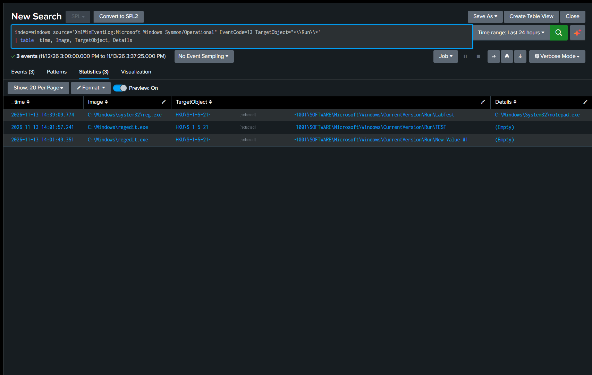

# Detection Practice 2.5: Persistence via Run Key (Sysmon 13)

| | |
|---|---|
| **Type** | Detection search (not yet scheduled) |
| **Data source** | Sysmon Event ID 13 (Registry Value Set) |
| **MITRE ATT&CK** | [T1547.001 Boot or Logon Autostart Execution: Registry Run Keys / Startup Folder](https://attack.mitre.org/techniques/T1547/001/) |
| **Severity** | Medium |
| **Status** | ✅ Tested: 3 Run key writes found in Splunk (`regedit.exe` and `reg.exe`) |

## What it detects

Programs listed under a **Run key** are started by Windows at every logon. Malware that only lives in memory is gone after a reboot; adding itself to a Run key lets it come back without attacking again (**persistence**).

| Location | Applies to | Needs admin |
|---|---|---|
| `HKCU\Software\Microsoft\Windows\CurrentVersion\Run` | The current user only | No |
| `HKLM\Software\Microsoft\Windows\CurrentVersion\Run` | Every user on the host | Yes |

HKCU is the most common choice for attackers because it needs no admin rights.

| Field | Meaning |
|---|---|
| `Image` | Process that wrote to the registry |
| `TargetObject` | Full path of the value that was written, including its name |
| `Details` | The data: the command that will run at logon |

## Attack simulation

On the lab VM, a harmless value that would open Notepad at logon. Done twice, with two tools:

1. **Registry Editor** (`regedit.exe`): created a new string value under the HKCU Run key and renamed it to `TEST`.
2. **Command line** (`reg.exe`):
   ```cmd
   reg add "HKCU\Software\Microsoft\Windows\CurrentVersion\Run" /v LabTest /t REG_SZ /d "C:\Windows\System32\notepad.exe" /f
   ```

Clean-up afterwards:

```cmd
reg delete "HKCU\Software\Microsoft\Windows\CurrentVersion\Run" /v LabTest /f
```

## SPL

```spl
index=windows source="XmlWinEventLog:Microsoft-Windows-Sysmon/Operational" EventCode=13 TargetObject="*\\Run\\*"
| table _time, Image, TargetObject, Details
```

| Line | Why |
|---|---|
| `EventCode=13` | A registry value was set |
| `TargetObject="*\\Run\\*"` | Wildcard instead of a full path, because HKCU is logged as `HKU\<SID>\...` (see findings) and so that HKLM is covered too |
| `Details` | What will actually be executed at logon |

## Results

Times are UTC. The middle of the user SID is masked.

| _time | Image | TargetObject | Details |
|---|---|---|---|
| 2026-11-13 14:01:49.351 | `C:\Windows\regedit.exe` | `HKU\S-1-5-21-…-1001\SOFTWARE\Microsoft\Windows\CurrentVersion\Run\New Value #1` | `(Empty)` |
| 2026-11-13 14:01:57.241 | `C:\Windows\regedit.exe` | `HKU\S-1-5-21-…-1001\SOFTWARE\Microsoft\Windows\CurrentVersion\Run\TEST` | `(Empty)` |
| 2026-11-13 14:39:09.774 | `C:\Windows\system32\reg.exe` | `HKU\S-1-5-21-…-1001\SOFTWARE\Microsoft\Windows\CurrentVersion\Run\LabTest` | `C:\Windows\System32\notepad.exe` |



**Findings:**
- **HKCU is not written as `HKCU`.** Sysmon logs it as `HKU\<user SID>\...`, so a search for the literal string `HKCU` finds nothing. The wildcard on `\Run\` handles both hives.
- **One action in Registry Editor produced two events**, 8 seconds apart: the value first appears under the default name `New Value #1`, then again under the name I gave it (`TEST`). Both have `Details` = `(Empty)` because no data had been entered yet.
- **`reg.exe` produced a single event** with the full command in `Details`.
- `Image` shows **which tool** made the change, which is the main thing to judge.

## Analysis

A Run key entry is not malicious by itself; OneDrive and many other applications use one. Three things decide:

| Look at | Expected | Suspicious |
|---|---|---|
| `Details` (what runs) | A program under `C:\Program Files\...` | A file in `Temp`, `AppData`, `Public`, `Downloads`, or a `powershell -enc ...` command |
| `Image` (who wrote it) | An installer, or the application itself | `reg.exe`, `powershell.exe`, `cmd.exe`, an Office application |
| Value name | Matches the software | Random, or imitating Windows (e.g. `WindowsUpdate`) |

In this test the `reg.exe` event is already the suspicious pattern: legitimate software rarely registers itself through `reg.exe`.

The same action is also visible from the process side: the `reg add` command is logged as **Event ID 1** with its `CommandLine` and `ParentImage` ([2.1](sysmon-process-baseline-eid1.md)). Two events, one action: who ran `reg.exe`, and what changed in the registry.

Raise to **High** when `Details` points to a user-writable folder or contains an encoded command.

## Tuning ideas

- Deleting a value is **Event ID 12** (`EventType` = `DeleteValue`), not 13. Not searched for in this run; adding it would show the full create → delete cycle.
- Extend the filter to `RunOnce` and the other autostart keys.
- Alert only when `Image` is a scripting or command-line tool, or when `Details` matches `*\\Temp\\*`, `*\\AppData\\*`, `*-enc*`.
