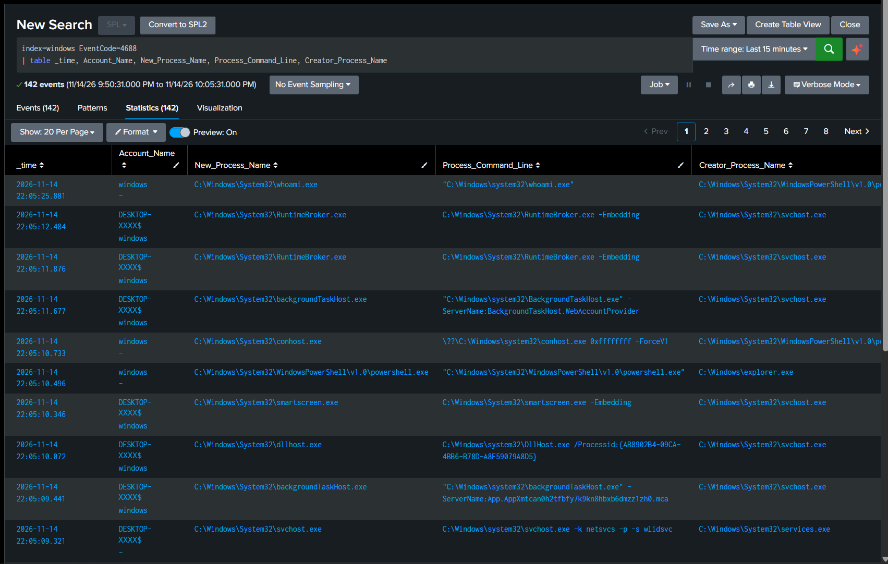
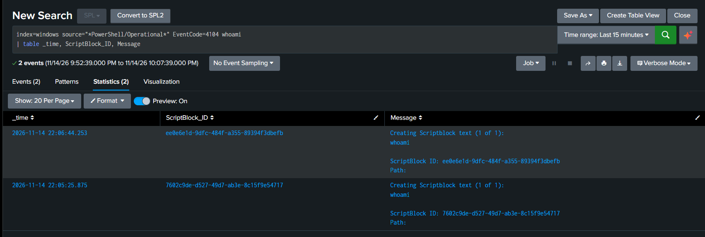
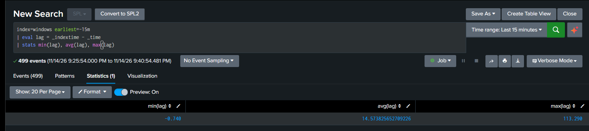
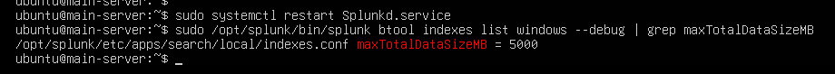

# Log Visibility: Command Lines (4688), PowerShell Script Blocks (4104), Time Sync, Index Size

| | |
|---|---|
| **Type** | Log source configuration (no new detection) |
| **Data sources added** | Security Event ID 4688 with command line; `Microsoft-Windows-PowerShell/Operational` Event ID 4104 |
| **MITRE ATT&CK** | Adds visibility for [T1059.001 PowerShell](https://attack.mitre.org/techniques/T1059/001/) and [T1027.010 Command Obfuscation](https://attack.mitre.org/techniques/T1027/010/) |
| **Status** | ✅ 3.1, 3.2, 3.4 and 3.5 done and verified. 3.3 (separate index) skipped, it is optional |

A detection is only as good as the logs behind it. This phase adds no new search; it adds the log sources that were still missing and tidies up the two things every search depends on: time and storage.

| # | Task | Result |
|---|---|---|
| 3.1 | Process creation with command line (4688) | A built-in second source for process starts, next to Sysmon 1 |
| 3.2 | PowerShell Script Block Logging (4104) | Encoded commands show up decoded |
| 3.3 | Separate `sysmon` index | Skipped (optional) |
| 3.4 | Clock and time zone on both VMs | Event time and index time agree to within a second |
| 3.5 | Index size limit | The `windows` index can no longer fill the disk |

All endpoint settings are collected in [`endpoint/enable-logging.ps1`](../endpoint/enable-logging.ps1).

---

## 3.1 Process creation with command line (4688)

Windows does not log process starts by default. Two separate settings are needed:

| Setting | What it does | Where it lives |
|---|---|---|
| Audit Process Creation | Writes Event ID **4688** to the Security log for every new process | Audit policy (`auditpol`) |
| Include command line in process creation events | Adds the full command line to 4688 | Registry value |

Without the second setting, 4688 only says `powershell.exe` was started. The arguments are what separate normal use from an attack.

### Finding: `gpedit.msc` on Windows 10 Home

The usual way to set both is Local Group Policy. The lab VM runs Windows 10 **Home**, which does not ship the editor. I installed it with a command found online, enabled both settings in it, and then checked:

```
PS> auditpol /get /subcategory:"Process Creation"
  Process Creation                        No Auditing

PS> reg query "HKLM\Software\Microsoft\Windows\CurrentVersion\Policies\System\Audit" /v ProcessCreationIncludeCmdLine_Enabled
ERROR: The system was unable to find the specified registry key or value.
```

The editor had saved my choices, but neither one had reached the system. The editor and the part of Windows that applies its settings are two different things, and Group Policy is not supported on Home. So I set both directly instead.

### Enable

PowerShell as Administrator:

```powershell
auditpol /set /subcategory:"Process Creation" /success:enable

$path = "HKLM:\Software\Microsoft\Windows\CurrentVersion\Policies\System\Audit"
if (-not (Test-Path $path)) { New-Item -Path $path | Out-Null }
New-ItemProperty -Path $path -Name "ProcessCreationIncludeCmdLine_Enabled" -Value 1 -PropertyType DWord -Force
```

| Line | Why |
|---|---|
| `auditpol /set ... /success:enable` | Turns on the audit subcategory; same effect as ticking *Success* in the policy editor |
| `Test-Path` / `New-Item` | The `Audit` key did not exist yet |
| `New-ItemProperty ... -Value 1 -PropertyType DWord` | The value Windows reads to decide whether 4688 carries the command line |

### Verify

```powershell
auditpol /get /subcategory:"Process Creation"        # Success
Get-ItemProperty -Path $path -Name "ProcessCreationIncludeCmdLine_Enabled"   # 1
```

Then a recognisable command (`whoami`, typed in a new PowerShell window) and a search in Splunk:

```spl
index=windows EventCode=4688
| table _time, Account_Name, New_Process_Name, Process_Command_Line, Creator_Process_Name
```

`whoami.exe` is the first row, started by `powershell.exe` (`Creator_Process_Name`). The rows below it show why the command line matters: `svchost.exe -k netsvcs -p -s wlidsvc` tells which services that `svchost.exe` is hosting; the process name alone does not.



*The computer name in `Account_Name` is redacted (`DESKTOP-XXXX$`).*

### 4688 compared with Sysmon Event ID 1

Sysmon 1 already recorded the command line (exercises 2.1 and 2.2). What is new is a **second, independent source** for the same activity.

| | Security 4688 | Sysmon 1 |
|---|---|---|
| Needs installing | No, built in | Yes |
| Command line of the process | Yes (`Process_Command_Line`) | Yes (`CommandLine`) |
| Parent process | Name only (`Creator_Process_Name`) | Name and command line (`ParentImage`, `ParentCommandLine`) |
| File hash | No | Yes (`Hashes`) |
| Unique process ID | PID only, which Windows reuses | `ProcessGuid` |
| What gets logged | Every process | What the Sysmon config lets through |

Both events for one command, side by side:

```spl
index=windows whoami (EventCode=4688 OR EventCode=1)
| table _time, source, EventCode, New_Process_Name, Process_Command_Line, Creator_Process_Name, Image, CommandLine, ParentImage, ParentCommandLine, Hashes
```

Sysmon is richer for an investigation. 4688 is there on every Windows machine, catches the processes a Sysmon config filters out, and keeps logging if Sysmon is stopped.

---

## 3.2 PowerShell Script Block Logging (4104)

In exercise 2.2 an encoded command was visible only as Base64 (`powershell -enc dwBoAG8AYQBtAGkA`) and had to be decoded by hand. Script Block Logging records the code at the moment PowerShell executes it, **after** decoding, as Event ID **4104** in the `Microsoft-Windows-PowerShell/Operational` log.

### Enable

Same pattern as 3.1: a registry value instead of Group Policy.

```powershell
$path = "HKLM:\SOFTWARE\Policies\Microsoft\Windows\PowerShell\ScriptBlockLogging"
if (-not (Test-Path $path)) { New-Item -Path $path -Force | Out-Null }
New-ItemProperty -Path $path -Name "EnableScriptBlockLogging" -Value 1 -PropertyType DWord -Force
```

`New-Item` needs `-Force` here because two levels of the path (`PowerShell\ScriptBlockLogging`) were missing. It is only used when the key does not exist: on an existing key, `-Force` removes the values inside it.

### Verify on the endpoint first

The setting applies to PowerShell sessions opened after the change. In a new window:

```powershell
Write-Output "tes-4104"

Get-WinEvent -LogName "Microsoft-Windows-PowerShell/Operational" -MaxEvents 20 |
    Where-Object Id -eq 4104 |
    Format-List TimeCreated, Message
```

Checking in Windows before Splunk separates two possible problems: the event is not being written, or it is written but not forwarded.

### Forward it

This log is a separate channel from Security, so the forwarder needs a new input ([`forwarder/inputs.conf`](../forwarder/inputs.conf)), followed by `Restart-Service SplunkForwarder`:

```ini
[WinEventLog://Microsoft-Windows-PowerShell/Operational]
disabled = 0
index = windows
```

### Result

The encoded `whoami` from exercise 2.2, run again:

```spl
index=windows source="*PowerShell/Operational*" EventCode=4104 whoami
| table _time, ScriptBlock_ID, Message
```

The `Message` field reads `Creating Scriptblock text (1 of 1): whoami`. The Base64 string is nowhere in this event.



**Findings:**
- **One PowerShell run produces several 4104 events**, one per script block, including PowerShell's own internal code. The first 4104 I opened contained `$global:?`, not my command. Searching for the text (`EventCode=4104 whoami`) finds the right one.
- One action now leaves three events, and each shows something the others do not:

  | Source | What it shows |
  |---|---|
  | Security 4688 | `powershell -enc dwBoAG8AYQBtAGkA` was started, and by which account |
  | Sysmon 1 | The same, plus the file hash and the parent's command line |
  | PowerShell 4104 | `whoami`: what was actually executed |

  ```spl
  index=windows (EventCode=4688 OR EventCode=1 OR EventCode=4104) (powershell OR whoami)
  | table _time, EventCode, Process_Command_Line, CommandLine, Message
  ```

- The log records the logging too: my own `Get-WinEvent` query shows up as a 4104 event.

---

## 3.3 Separate index (skipped)

Splitting the data into `windows` and `sysmon` indexes would make searches faster and allow different retention per source. It is optional and I left it for later. If it is done, every saved search and alert that uses `index=windows` for Sysmon data has to be updated.

---

## 3.4 Clock and time zone on both VMs

Correlating events from two machines only works if they agree on the time. While testing 3.2, one event showed three different times:

| Where | Time shown | Time zone |
|---|---|---|
| Raw event text (Windows VM) | 06:03:18 AM | UTC−8 |
| Splunk Web | 2:03:18 PM | UTC |
| My own clock | 21:03 | UTC+7 (WIB) |

All three are the same moment. The clocks agreed; only the time zones differed. That does not corrupt the data, but it makes every timestamp harder to read.

### Fix

| Where | Command / setting |
|---|---|
| Windows VM | `Set-TimeZone -Id "SE Asia Standard Time"` (UTC+7), then `w32tm /resync` |
| Ubuntu VM | `sudo timedatectl set-timezone Asia/Jakarta`, `sudo timedatectl set-ntp true` |
| Splunk Web | User menu → *Preferences* → *Time zone* |

Then both services were restarted (`Restart-Service SplunkForwarder`, `sudo systemctl restart Splunkd.service`).

### Verify

`_time` is when the event happened according to the Windows clock; `_indextime` is when Splunk received it according to the Ubuntu clock. The difference shows whether the two clocks agree:

```spl
index=windows earliest=-15m
| eval lag = _indextime - _time
| stats min(lag), avg(lag), max(lag)
```

Result over 499 events:

| min(lag) | avg(lag) | max(lag) |
|---|---|---|
| -0.740 s | 14.6 s | 113.3 s |



**How to read it:**
- **`min` close to zero means the clocks agree.** A clock that is off shifts every event by the same amount, so `min` would move with it (a Windows clock 5 minutes behind gives a `min` of about 300).
- The small negative value is rounding: `_indextime` is stored in whole seconds, `_time` keeps the fraction.
- **`max` and `avg` measure delivery delay, not clock error.** The 113 seconds most likely come from the forwarder restart just before the search: events written while the service was down were sent in one batch afterwards.

---

## 3.5 Index size limit

Earlier in this lab the indexer stopped writing because free disk space fell below Splunk's 5000 MB minimum (see the troubleshooting log in the [README](../README.md)). The default size limit of an index is 500000 MB, far more than the VM's disk, so in practice nothing was limiting the `windows` index.

`maxTotalDataSizeMB` sets the maximum size of one index. When it is exceeded, Splunk removes the oldest buckets.

### Find the file, then set the limit

`btool` shows the configuration Splunk really uses; `--debug` adds the file each setting comes from:

```bash
sudo /opt/splunk/bin/splunk btool indexes list windows --debug | grep -E "homePath|maxTotalDataSizeMB"
```

The `[windows]` stanza lives in `/opt/splunk/etc/apps/search/local/indexes.conf`. One line added there (copy in [`server/indexes.conf`](../server/indexes.conf)):

```ini
[windows]
coldPath = $SPLUNK_DB/windows/colddb
homePath = $SPLUNK_DB/windows/db
maxTotalDataSizeMB = 5000
thawedPath = $SPLUNK_DB/windows/thaweddb
```

### Verify

```
$ sudo systemctl restart Splunkd.service
$ sudo /opt/splunk/bin/splunk btool indexes list windows --debug | grep maxTotalDataSizeMB
/opt/splunk/etc/apps/search/local/indexes.conf maxTotalDataSizeMB = 5000
```

The value is 5000 and comes from the file I edited, not from a default.



---

## Lessons

- **Configured is not the same as active.** The policy editor showed both settings as enabled; `auditpol /get` and the registry showed they were not. Read the setting back from the system, not from the tool that set it.
- **Verify at the source before the SIEM.** `Get-WinEvent` on the endpoint tells whether a missing event is a logging problem or a forwarding problem.
- **One log source is not enough.** 4688 and Sysmon 1 show that encoded PowerShell ran; only 4104 shows what it did.
- **Check time before correlating.** `_indextime - _time` is a quick test that needs nothing but Splunk.
